# Cangjie SDK Build Guide (Ubuntu 22.04)

## 1 Build Overview

### 1.1 Build Process Flowchart

```mermaid
graph LR
    A[Prepare Environment] --> B[Compile Core<br>Dependencies]
    B --> C[Create<br>Workspace]
    C --> D[Obtain<br>Cangjie Source Code]
    D --> E[Compile Cangjie<br>Compiler and Debugger]
    E --> F[Compile<br>Cangjie Runtime]
    F --> G[Compile<br>Cangjie Standard Library]
    G --> H[Compile<br>STDX Extension Library]
    H --> I[Compile<br>Cangjie Toolset]
    I --> J[Organize and<br>Package Files]
    J --> K[Compile<br>Hello,Cangjie Program]
```



### 1.2 Key Considerations

1. **Static Compilation (Optional)**: libedit and ncurses libraries must be compiled as static versions from source to ensure the generated SDK runs stably on Linux distributions meeting the following conditions:
   - glibc version ≥ compilation environment version
   - Linux Kernel version matches compilation environment
2. **Environment Isolation**: All custom dependencies are installed in `/opt/buildtools` to avoid polluting system paths
3. **Memory Requirements**: Full build requires ≥8GB RAM, recommend adding 4GB swap space
4. **Network Requirements**: Initial build requires downloading approximately 3GB data - ensure stable network connection
5. **Chip Instruction Set**: **Must** set corresponding environment variables based on your computer's chip architecture (x86_64 or aarch64), and select appropriate system tools and docker images (uname -m)

## 2 Environment Preparation

### 2.1 System Requirements

- **OS**: Ubuntu 22.04 LTS
- **Disk Space**: ≥50GB
- **Memory**: ≥8GB (physical + swap)
- **User Permissions**: Regular user + sudo privileges

> You can set up the build environment yourself or use our provided Docker environment which includes all system tools and build tools required for Cangjie SDK:
>
> ```bash
> docker pull swr.cn-north-4.myhuaweicloud.com/cj-docker/cangjie_ubuntu22_x86_kernel:v1.2
> # or
> docker pull swr.cn-north-4.myhuaweicloud.com/cj-docker/cangjie_ubuntu22_arm_kernel:v1.2
> ```

### 2.2 System Tools Installation

- Use Huawei mirror (optional)

  ```bash
  # 1.Backup config:
  sudo cp -a /etc/apt/sources.list /etc/apt/sources.list.bak;
  # 2.Modify sources.list, replace http://archive.ubuntu.com and http://security.ubuntu.com with http://mirrors.huaweicloud.com:
  sudo sed -i "s@http://.*archive.ubuntu.com@http://mirrors.huaweicloud.com@g" /etc/apt/sources.list;
  sudo sed -i "s@http://.*security.ubuntu.com@http://mirrors.huaweicloud.com@g" /etc/apt/sources.list;
  # 3.Update index
  sudo apt-get update;
  ```

- Install system tools

  ```bash
  sudo apt update && sudo apt install -y \
    tar unzip wget curl libcurl4 expat openssl make gcc g++ gettext \
    nfs-common libtool sqlite3 zlib1g-dev libssl-dev cmake ninja-build\
    libcurl4-openssl-dev sudo autoconf build-essential rapidjson-dev \
    texinfo binutils expat libelf-dev libdwarf-dev openssh-client ssh \
    dos2unix libxext-dev libxtst-dev libxt-dev libcups2-dev clang clang-15 libedit-dev\
    libxrender-dev zip bzip2 libopenmpi-dev vim gdb lldb libclang-15-dev libgtest-dev\
    rpm patch libtinfo5 cpio rpm2cpio libncurses5 libncurses5-dev strace net-tools;
  ```

### 2.3 Static Library Compilation (Optional)

libedit and ncurses libraries **don't need to be compiled from source** - precompiled system versions can be used.

```bash
# Create working directory
export BUILD_ROOT=/opt/buildtools;
sudo mkdir -p $BUILD_ROOT;
sudo chown $USER:$USER $BUILD_ROOT;
tmp_cpus=$(grep -w processor /proc/cpuinfo|wc -l);
```

#### (1) Compile ncurses 6.3 (static)

```bash
cd $BUILD_ROOT;
wget https://invisible-island.net/archives/ncurses/ncurses-6.3.tar.gz -q --no-check-certificate;
tar -zxvf ncurses-6.3.tar.gz;
cd ncurses-6.3;
./configure --with-termlib CC=clang CXX=clang++ CFLAGS=-fPIC CPPFLAGS=-fPIC CFLAGS="-fstack-protector-strong -Wl,-z,relro,-z,now,-z,noexecstack" CXXFLAGS="-fstack-protector-strong -Wl,-z,relro,-z,now,-z,noexecstack" --with-terminfo-dirs=/etc/terminfo:/lib/terminfo:/usr/share/terminfo --disable-overwrite --disable-root-environ;
make -j ${tmp_cpus};
make install DESTDIR=${BUILD_ROOT}/ncurses-6.3;
```

#### (2) Compile libedit 3.1 (static)

```bash
cd $BUILD_ROOT;
wget https://www.thrysoee.dk/editline/libedit-20250104-3.1.tar.gz -q --no-check-certificate;
tar -zxvf libedit-20250104-3.1.tar.gz;
cd libedit-20250104-3.1;
./configure --with-pic --enable-shared=no --prefix=${BUILD_ROOT}/libedit-3.1;
make -j ${tmp_cpus};
make install;
```

### 2.4 Environment Variable Setup

#### (1) OpenSSL Environment Variables

Building Cangjie standard library and STDX extension library requires OpenSSL. We've already installed OpenSSL in section 2.2. Now we need to set the `OPENSSL_PATH` environment variable:

 - Locate OpenSSL lib directory
    
    Library location: Default in /usr/lib/x86_64-linux-gnu/ (x86_64) or /usr/lib/aarch64-linux-gnu/ (aarch64)
    
    Verification method:
    
    ```bash
    # Find libssl.so
    ls /usr/lib/x86_64-linux-gnu/libssl.so*
    # Find libcrypto.so
    ls /usr/lib/x86_64-linux-gnu/libcrypto.so*
    ```
 - Set OPENSSL_PATH environment variable

    ```bash
    export OPENSSL_PATH=/usr/lib/x86_64-linux-gnu;
    export LD_LIBRARY_PATH=$OPENSSL_PATH:$LD_LIBRARY_PATH
    ```

#### (2) Other Environment Variables

Must configure these environment variables before building:

```bash
export PATH=/usr/lib/llvm-15/bin:$PATH; # Add clang-15 to PATH
export ARCH=x86_64 # or aarch64
export SDK_NAME=linux-x64 # or linux-aarch64
# Following variables only affect filenames
export CANGJIE_VERSION=1.0.0
export STDX_VERSION=1
```

## 3. Source Code Preparation

### 3.1 Create Workspace

**<font color="red">\* Replace `/path/to/workspace` in the example below with your actual Cangjie SDK build directory</font>**

```bash
export WORKSPACE=/path/to/workspace
mkdir -p $WORKSPACE;
cd $WORKSPACE;
```

### 3.2 Obtain Cangjie Source Code

```bash
git clone https://gitcode.com/Cangjie/cangjie_compiler.git;
git clone https://gitcode.com/Cangjie/cangjie_runtime.git;
git clone https://gitcode.com/Cangjie/cangjie_tools.git;
git clone https://gitcode.com/Cangjie/cangjie_stdx.git;
```

## 4 Build Process

### 4.1 Compile Cangjie Compiler and Debugger

> You can use CMAKE_PREFIX_PATH and --target-lib to specify your compiled static libraries (optional)

```bash
export CMAKE_PREFIX_PATH=$BUILD_ROOT/libedit-3.1:$BUILD_ROOT/ncurses-6.3/usr;
```

Execute build:

```bash
cd $WORKSPACE/cangjie_compiler;
python3 build.py clean;
python3 build.py build -t release \
  --no-tests \
  --target-lib=$BUILD_ROOT/ncurses-6.3/usr/lib \
  --build-cjdb;
python3 build.py install;
```

Verify installation:
```bash
source output/envsetup.sh;
cjc -v;
```

### 4.2 Compile Cangjie Runtime

```bash
cd $WORKSPACE/cangjie_runtime/runtime;
python3 build.py clean;
python3 build.py build -t release -v ${CANGJIE_VERSION};
python3 build.py install;
cp -R output/common/linux_release_${ARCH}/{lib,runtime} $WORKSPACE/cangjie_compiler/output;
```

### 4.3 Compile Cangjie Standard Library

```bash
cd $WORKSPACE/cangjie_runtime/std;
python3 build.py clean;
python3 build.py build -t release \
  --target-lib=$WORKSPACE/cangjie_runtime/runtime/output \
  --target-lib=$OPENSSL_PATH;
python3 build.py install;
cp -R $WORKSPACE/cangjie_runtime/std/output/* $WORKSPACE/cangjie_compiler/output/;
```

### 4.4 Compile STDX Extension Library

```bash
cd $WORKSPACE/cangjie_stdx;
python3 build.py clean;
python3 build.py build -t release \
  --include=$WORKSPACE/cangjie_compiler/include \
  --target-lib=$OPENSSL_PATH;
python3 build.py install;
export CANGJIE_STDX_PATH=$WORKSPACE/cangjie_stdx/target/linux_${ARCH}_cjnative/static/stdx;
```

### 4.5 Compile Toolset

#### (1) cjpm

```bash
cd $WORKSPACE/cangjie_tools/cjpm/build;
python3 build.py clean;
python3 build.py build -t release --set-rpath \$ORIGIN/../../runtime/lib/linux_${ARCH}_cjnative;
python3 build.py install;
```

#### (2) cjfmt

```bash
cd $WORKSPACE/cangjie_tools/cjfmt/build;
python3 build.py clean;
python3 build.py build -t release;
python3 build.py install;
```

#### (3) HyperLangExtension

```bash
cd $WORKSPACE/cangjie_tools/hyperlangExtension/build;
python3 build.py clean;
python3 build.py build -t release;
python3 build.py install;
```

#### (4) LSP Server

```bash
cd $WORKSPACE/cangjie_tools/cangjie-language-server/build;
python3 build.py clean;
python3 build.py build -t release;
python3 build.py install;
```

## 5 Organize and Package Files

### 5.1 Organize and Package SDK

```bash
# Clear previous builds
mkdir -p $WORKSPACE/software;
rm -rf $WORKSPACE/software/*;
cd $WORKSPACE/software;

# Copy cangjie directory
cp -R $WORKSPACE/cangjie_compiler/output cangjie;

# Remove ast-support.a
rm -rf cangjie/lib/linux_${ARCH}_cjnative/libcangjie-ast-support.a

# Organize files
cp $WORKSPACE/cangjie_tools/cjpm/dist/cjpm cangjie/tools/bin/cjpm;
mkdir -p cangjie/tools/config;
cp $WORKSPACE/cangjie_tools/cjfmt/build/build/bin/cjfmt cangjie/tools/bin;
cp $WORKSPACE/cangjie_tools/cjfmt/config/*.toml cangjie/tools/config;
cp $WORKSPACE/cangjie_tools/hyperlangExtension/target/bin/main cangjie/tools/bin/hle;
cp -r $WORKSPACE/cangjie_tools/hyperlangExtension/src/dtsparser cangjie/tools;
rm -rf cangjie/tools/dtsparser/*.cj;
cp $WORKSPACE/cangjie_tools/cangjie-language-server/output/bin/LSPServer cangjie/tools/bin;

# Package and set permissions
chmod -R 750 cangjie
tar --format=gnu -zcvf cangjie-sdk-${SDK_NAME}-${CANGJIE_VERSION}.tar.gz cangjie;
chmod 550 cangjie-sdk-${SDK_NAME}-${CANGJIE_VERSION}.tar.gz;
```### 5.2 Organizing and Packaging STDX

```bash
cd $WORKSPACE/software;
# Copy the stdx directory
cp -r $WORKSPACE/cangjie_stdx/target/linux_${ARCH}_cjnative ./;
chmod -R 750 linux_${ARCH}_cjnative;
zip -qr cangjie-stdx-${SDK_NAME}-${CANGJIE_VERSION}.${STDX_VERSION}.zip linux_${ARCH}_cjnative;
chmod 550 cangjie-stdx-${SDK_NAME}-${CANGJIE_VERSION}.${STDX_VERSION}.zip;
```

## 6 Compiling the Hello, Cangjie Program

Check the generated files:

```bash
ls -lh $WORKSPACE/software
# The following files should be present:
# - cangjie-sdk-${SDK_NAME}-${CANGJIE_VERSION}.tar.gz
# - cangjie-stdx-${SDK_NAME}-${CANGJIE_VERSION}.${STDX_VERSION}.zip
```

Verify the Hello, Cangjie program:

```bash
cd $WORKSPACE;
source $WORKSPACE/software/cangjie/envsetup.sh;
echo "main() { println(\"Hello, Cangjie\") }" > hello.cj
cjc hello.cj -o hello && ./hello
# You should see the following output in the console:
# Hello, Cangjie
```

🎉 Congratulations! You have successfully built and run the Cangjie SDK and executed the Hello, Cangjie program!