# OHOS Cangjie SDK Build Guide (macOS 14 Sonoma)

## 1 Build Overview

### Build Process Flowchart

```mermaid
graph LR
    A[Prepare<br>Environment] --> B[Create<br>Workspace]
    B --> C[Obtain<br>Cangjie Source Code]
    C --> D[Build Cangjie<br>Compiler and Debugger]
    D --> E[Build<br>Cangjie Runtime]
    E --> F[Build<br>Cangjie Standard Library]
    F --> G[Build<br>STDX Extension Library]
    G --> H[Build<br>Cangjie Toolset]
    H --> I[Organize and<br>Package Files]
    I --> J[Build<br>Hello,Cangjie Program]
```



## 2 Environment Preparation

### 2.1 System Requirements

- **Operating System**: macOS 14 Sonoma
- **Disk Space**: ≥200GB
- **Memory**: ≥8GB (Physical + Swap)
- **User Permissions**: Regular user + sudo privileges
- **Chip Instruction Set**: Set corresponding environment variables based on your computer's architecture (x86_64 or aarch64)

### 2.2 System Tools Installation

Recommended to use `Homebrew` for installing dependencies:

 - [Homebrew Official Site](https://brew.sh/zh-cn/)
 - [Homebrew China Mirror](https://developer.aliyun.com/mirror/homebrew/)

#### (1) Install Required Dependencies:

**1. cmake (Requirement: ≥3.17, <4)**

Download dmg or tar.gz package from [CMake Official Site](https://cmake.org/download/#previous) for manual installation:

- Using dmg: After downloading, drag to Applications and execute:

  **<font color="red">\* Replace `/path/to/cmake` in examples below with your custom installation directory</font>**

  ```bash
  # Choose one of the following commands:
  # Install to /usr/local/bin
  sudo "/Applications/CMake.app/Contents/bin/cmake-gui" --install
  # Custom installation location
  sudo "/Applications/CMake.app/Contents/bin/cmake-gui" --install=/path/to/cmake
  
  # Add cmake/bin to PATH before use
  PATH="/Applications/CMake.app/Contents/bin:$PATH”
  ```

- Using tar.gz: 

  ```bash
  # Extract tar package
  tar -zxvf cmake-3.x.x-macos-universal.tar.gz /path/to/cmake
  # Add cmake/bin to PATH or add to ~/.zshrc
  export PATH="/path/to/cmake/bin:$PATH"
  ```

#### (2) Other Essential Build Tools

```bash
brew install python3 ninja llvm@16 openssl@3 m4 bison googletest gnu-tar
```

### 2.3 Build ohos-x86_64, ohos-aarch64 Toolchain
[Refer to Building ohos-x86_64, ohos-aarch64 Toolchain](linux_ohos_toolchain.md)

### 2.4 Set Environment Variables

***Must set these variables before building:***

```bash
export ARCH=aarch64 # or x86_64
export SDK_NAME=mac-aarch64 # or mac-x64
# Following variables only affect filenames
export CANGJIE_VERSION=1.0.0
export STDX_VERSION=1
```

**<font color="red">\* Note: Below build tool versions must be replaced with your actual installed versions</font>**

**<font color="red">\* Replace version placeholders like 16.x, 1.x, 3.x with your specific version numbers</font>**

```bash
export CELLAR_PATH=/path/to/Cellar
# Use `brew --cellar` to check location
# For ARM chips, Cellar typically at: /opt/homebrew/Cellar
# For Intel chips, Cellar typically at: /usr/local/Cellar

# How to find version numbers:
# Use `brew list --versions` to check installed packages and versions, e.g.:
# brew list --versions llvm@16
export PATH=$CELLAR_PATH/llvm@16/16.x/bin:$CELLAR_PATH/m4/1.x/bin:$PATH
export OPENSSL_PATH=$CELLAR_PATH/openssl@3/3.x/lib
export LD_LIBRARY_PATH=$OPENSSL_PATH:$LD_LIBRARY_PATH
```

## 3 Source Code Preparation

### 3.1 Create Workspace

**<font color="red">\* Replace `/path/to/workspace` in examples below with your Cangjie SDK build directory</font>**

```bash
export WORKSPACE=/path/to/workspace
mkdir -p $WORKSPACE;
cd $WORKSPACE;
```

### 3.2 Obtain Cangjie Source Code

```bash
git clone https://gitcode.com/Cangjie/cangjie_compiler.git;
git clone https://gitcode.com/Cangjie/cangjie_runtime.git;
git clone https://gitcode.com/Cangjie/cangjie_tools.git;
git clone https://gitcode.com/Cangjie/cangjie_stdx.git;
```

## 4 Build Process

### 4.1 Build Cangjie Compiler and Debugger

Execute build:
```bash
cd $WORKSPACE/cangjie_compiler;
python3 build.py clean;
python3 build.py build -t release --build-cjdb;
python3 build.py install;
export OHOS_ROOT=/opt/buildtools/ohos_root;
python3 build.py build -t release \
  --product libs \
  --target ohos-x86_64  \
  --target-toolchain ${OHOS_ROOT}/prebuilts/clang/ohos/${kernel}-${cmake_arch}/llvm/bin \
  --target-sysroot ${OHOS_ROOT}/out/sdk/obj/third_party/musl/sysroot;
python3 build.py install;
python3 build.py build -t release \
  --product libs \
  --target ohos-aarch64  \
  --target-toolchain ${OHOS_ROOT}/prebuilts/clang/ohos/${kernel}-${cmake_arch}/llvm/bin \
  --target-sysroot ${OHOS_ROOT}/out/sdk/obj/third_party/musl/sysroot;
python3 build.py install;
```

Verify installation:
```bash
source output/envsetup.sh;
cjc -v;
```

### 4.2 Build Cangjie Runtime

```bash
cd $WORKSPACE/cangjie_runtime/runtime;
python3 build.py clean;
python3 build.py build -t release -v ${CANGJIE_VERSION};
python3 build.py install;
cp -R $WORKSPACE/cangjie_runtime/runtime/output/common/darwin_release_${ARCH}/{lib,runtime} $WORKSPACE/cangjie_compiler/output;
python3 build.py build -t release \
  --target ohos-x86_64 \
  --target-toolchain ${OHOS_ROOT} \
  -v ${cangjie_version};
python3 build.py install;
cp -rf ${WORKSPACE}/cangjie_runtime/runtime/output/common/linux_ohos_release_x86_64/{lib,runtime} ${WORKSPACE}/cangjie_compiler/output;
python3 build.py build -t release \
  --target ohos-aarch64 \
  --target-toolchain ${OHOS_ROOT} \
  -v ${cangjie_version};
python3 build.py install;
cp -rf ${WORKSPACE}/cangjie_runtime/runtime/output/common/linux_ohos_release_aarch64/{lib,runtime} ${WORKSPACE}/cangjie_compiler/output;
```

### 4.3 Build Cangjie Standard Library

```bash
cd $WORKSPACE/cangjie_runtime/std;
python3 build.py clean;
python3 build.py build -t release \
  --target-lib=$WORKSPACE/cangjie_runtime/runtime/output \
  --target-lib=$OPENSSL_PATH;
python3 build.py build -t release \
    --target ohos-x86_64 \
    --target-lib=${WORKSPACE}/cangjie_runtime/runtime/output \
    --target-lib=${WORKSPACE}/cangjie_runtime/runtime/output/common \
    --target-toolchain ${OHOS_ROOT}/prebuilts/clang/ohos/${kernel}-${cmake_arch}/llvm/bin \
    --target-sysroot ${OHOS_ROOT}/out/sdk/obj/third_party/musl/sysroot;
python3 build.py build -t release \
    --target ohos-aarch64 \
    --target-lib=${WORKSPACE}/cangjie_runtime/runtime/output \
    --target-lib=${WORKSPACE}/cangjie_runtime/runtime/output/common \
    --target-toolchain ${OHOS_ROOT}/prebuilts/clang/ohos/${kernel}-${cmake_arch}/llvm/bin \
    --target-sysroot ${OHOS_ROOT}/out/sdk/obj/third_party/musl/sysroot;
python3 build.py install;
cp -R $WORKSPACE/cangjie_runtime/std/output/* $WORKSPACE/cangjie_compiler/output/;
```

### 4.4 Build STDX Extension Library

```bash
cd $WORKSPACE/cangjie_stdx;
python3 build.py clean;
python3 build.py build -t release \
  --include=$WORKSPACE/cangjie_compiler/include \
  --target-lib=$OPENSSL_PATH;
python3 build.py install;
export CANGJIE_STDX_PATH=$WORKSPACE/cangjie_stdx/target/darwin_${ARCH}_cjnative/static/stdx;
```

### 4.5 Build Cangjie Toolset

#### (1) cjpm

```bash
cd $WORKSPACE/cangjie_tools/cjpm/build;
python3 build.py clean;
python3 build.py build -t release --set-rpath @loader_path/../../runtime/lib/darwin_${ARCH}_cjnative;
python3 build.py install;
```

#### (2) cjfmt

```bash
cd $WORKSPACE/cangjie_tools/cjfmt/build;
python3 build.py clean;
python3 build.py build -t release;
python3 build.py install;
```

#### (3) HyperLangExtension

```bash
cd $WORKSPACE/cangjie_tools/hyperlangExtension/build;
python3 build.py clean;
python3 build.py build -t release;
python3 build.py install;
```

#### (4) LSP Server

```bash
cd $WORKSPACE/cangjie_tools/cangjie-language-server/build;
python3 build.py clean;
python3 build.py build -t release;
python3 build.py install;
```

## 5 Organize and Package Files

### 5.1 Organize and Package SDK

```bash
# Clear previous builds
mkdir -p $WORKSPACE/software;
rm -rf $WORKSPACE/software/*;
cd $WORKSPACE/software;

# Copy cangjie directory
cp -R $WORKSPACE/cangjie_compiler/output cangjie;

# Remove ast-support.a
rm -rf cangjie/lib/darwin_${ARCH}_cjnative/libcangjie-ast-support.a

# Organize files
cp $WORKSPACE/cangjie_tools/cjpm/dist/cjpm cangjie/tools/bin/cjpm;
mkdir -p cangjie/tools/config;
cp $WORKSPACE/cangjie_tools/cjfmt/build/build/bin/cjfmt cangjie/tools/bin;
cp $WORKSPACE/cangjie_tools/cjfmt/config/*.toml cangjie/tools/config;
cp $WORKSPACE/cangjie_tools/hyperlangExtension/target/bin/main cangjie/tools/bin/hle;
cp -r $WORKSPACE/cangjie_tools/hyperlangExtension/src/dtsparser cangjie/tools;
rm -rf cangjie/tools/dtsparser/*.cj;
cp $WORKSPACE/cangjie_tools/cangjie-language-server/output/bin/LSPServer cangjie/tools/bin;

# Package and set permissions
chmod -R 750 cangjie
gtar --format=gnu -zcvf cangjie-sdk-${SDK_NAME}-${CANGJIE_VERSION}.tar.gz cangjie;
chmod 550 cangjie-sdk-${SDK_NAME}-${CANGJIE_VERSION}.tar.gz;
```

### 5.2 Organize and Package STDX

```bash
cd $WORKSPACE/software;
# Copy stdx directory
cp -r $WORKSPACE/cangjie_stdx/target/darwin_${ARCH}_cjnative ./;
chmod -R 750 darwin_${ARCH}_cjnative;
zip -qr cangjie-stdx-${SDK_NAME}-${CANGJIE_VERSION}.${STDX_VERSION}.zip darwin_${ARCH}_cjnative;
chmod 550 cangjie-stdx-${SDK_NAME}-${CANGJIE_VERSION}.${STDX_VERSION}.zip;
```

## 6 Build Hello, Cangjie Program

Check generated files:```bash
ls -lh $WORKSPACE/software
# Should include:
# - cangjie-sdk-${SDK_NAME}-${CANGJIE_VERSION}.tar.gz
# - cangjie-stdx-${SDK_NAME}-${CANGJIE_VERSION}.${STDX_VERSION}.zip
```

Verify the Hello, Cangjie program:

```bash
   echo "main() { println(\"Hello, Cangjie\") }" > hello.cj
   # Mobile platform
   cjc hello.cj --target=aarch64-linux-ohos -B${OHOS_ROOT}/out/sdk/obj/third_party/musl/sysroot/usr/lib/aarch64-linux-ohos -L${OHOS_ROOT}/out/sdk/obj/third_party/musl/sysroot/usr/lib/aarch64-linux-ohos
   # Emulator platform
   cjc hello.cj --target=x86_64-linux-ohos -B${OHOS_ROOT}/out/sdk/obj/third_party/musl/sysroot/usr/lib/x86_64-linux-ohos -L${OHOS_ROOT}/out/sdk/obj/third_party/musl/sysroot/usr/lib/x86_64-linux-ohos
   # Expected output:
   # Hello, Cangjie
```
🎉 Congratulations! You have successfully built and run the Cangjie SDK and executed the Hello, Cangjie program!